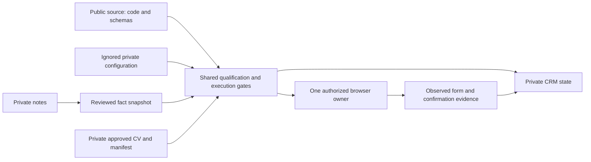

# Architecture

The source repository owns reviewed program behavior and example schemas. Private runtime storage owns an operator's facts, documents, jobs and outcomes. A source checkout is deliberately insufficient to restore an operator's identity or execution permissions.

## Components

| Component | Responsibility |
| --- | --- |
| React/Vinext app | Searchable CRM interface and authenticated API/MCP surface. |
| `lib/workflow-store.ts` and `lib/workflow-storage-core.ts` | Revision-checked persistence; compact D1 pointers with private R2 archives. |
| `lib/workspace-store.ts` | Projects exact workflow identities and manually maintained tracking without overwriting newer values. |
| `workflow/evidence_bootstrap.py` and `workflow/evidence.py` | Read explicitly selected private notes, preserve provenance and detect changed facts. |
| `workflow/qualification.py` and `workflow/target_policy.py` | Separate mandatory requirements, preferred requirements and operator targeting policy. |
| `workflow/resumes.py` and `workflow/maintenance.py` | Verify private fixed document bytes/manifest; activate only deliberate, reviewed revisions while paused. |
| `workflow/engine.py` and `workflow/safeguards.py` | Durable transitions, leases, duplicate checks, document/review binding and submission gates. |
| `workflow/mail_sync.py` and `workflow/email_reconcile.py` | Optional mailbox evidence and exact-identity outcome reconciliation. |
| Browser adapters | Optional supervised transport; disabled by default and subject to the same gates. |

## State and ownership

Candidate facts are not inferred from job descriptions or previously entered autofill. An operator selects source notes deliberately, builds a private snapshot and reviews it before import. A hash change invalidates dependent review packets. Missing facts remain unknown; they do not become zero or No.

Each application uses exact employer/requisition identity. A card, filled draft or attempted click is not a confirmed submission. Store attempted, UI-confirmed, receipt-confirmed and hiring outcomes separately. Preserve uncertain attempts and reconcile them before retrying. Email is an optional evidence source, never proof of an absent duplicate when unavailable.

One writer owns each private dataset and one browser owner controls application tabs. Independent researchers/reviewers work from saved evidence. New questions hold only the affected job. Successful tests, source publication, backups and document approval never create submission permission.

## Binding and persistence

Eligibility and final review are bound to exact source, policy, fact-snapshot and CV hashes. Changing any dependency requires re-review. Keep historical application artifact references immutable when approving a new CV. Do not regenerate or tailor a CV implicitly.

D1 revision compare-and-swap is the persistence commit point. Private R2 archives are content-addressed; missing or altered versions fail closed. Stale writers must reread and recompute. See [storage protocol](workflow/STORAGE.md).

## Public/private boundary

Git contains code, generic schemas, synthetic fixtures and documentation. An ignored private configuration points to the operator's private CV manifest, selection policy and service. Credentials come from runtime environment, explicit hidden input or an operator-configured credential store. Real CVs, mailbox identifiers, note bodies, CRM data, browser sessions, screenshots and deployment bindings stay outside Git. See [private setup](docs/PRIVATE_SETUP.md).

The app's gateway identity is a deployment trust boundary. A standalone deployment must provide real authentication and prevent callers from forging identity headers. Missing configuration or identity denies private API access; this repository does not ship a local identity bypass.
